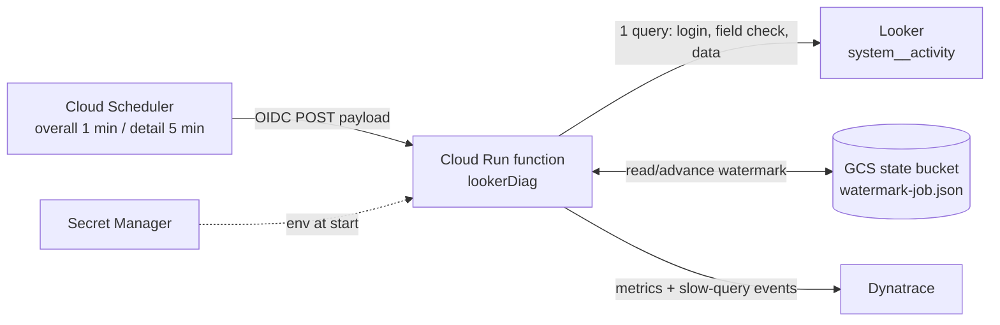

# GCP Looker Diagnostics → Dynatrace

Collects Looker performance diagnostics (the **Query Performance Metrics** Explore of the `system__activity` model) and sends them to Dynatrace:

- **Metrics** `custom.gcp.looker.*`: per-minute gauges (min/max/sum/count), bounded dimensions, via Metrics API v2 line protocol.
- **Slow-query events**: one OpenPipeline event per query above a configurable threshold, with query ID, masked SQL, the full timing breakdown and the same dimensions as the metrics.

Phase 1 only: no logs, no traces, no PDT Event Log Explore (documented future phase). **Status: written and unit-tested, not yet deployed to a real project.**



## Quick start

Prerequisites: a GCP project (billing on) where you are Owner (Terraform enables APIs and creates service accounts), `gcloud config set project <id>` plus Terraform ≥ 1.5 authenticated (`gcloud auth application-default login`), a Looker API user, and a Dynatrace platform token (see [Required permissions](#required-permissions)).

```bash
cd terraform
cp terraform.tfvars.example terraform.tfvars   # edit: project, region, Looker and Dynatrace URLs
terraform init && terraform apply              # creates everything; schedulers paused, secrets hold a REPLACE_ME placeholder

# replace the placeholders with the real values (read from stdin, never on the command line)
printf '%s' "$LOOKER_CLIENT_ID"     | gcloud secrets versions add looker-client-id --data-file=-
printf '%s' "$LOOKER_CLIENT_SECRET" | gcloud secrets versions add looker-client-secret --data-file=-
printf '%s' "$DT_TOKEN"             | gcloud secrets versions add dt-token --data-file=-

# set `schedulers_enabled = true` in terraform.tfvars, then:
terraform apply                                # start collecting
```

Then check [Verification in Dynatrace](#verification-in-dynatrace). Remove everything with `terraform destroy` (the watermarks go with the state bucket).


## Architecture and layout

Cloud Run function (2nd gen, Node.js 22, TypeScript) triggered by Cloud Scheduler (OIDC). One run reads one closed time window from Looker with **one** Looker query, aggregates it per minute, posts metrics and events, then advances a watermark in a GCS object.

Layout evaluated (27 timing metrics in 5 groups):

| | (a) per metric | (b) per group | (c) one codebase, group payload |
|---|---|---|---|
| Scheduler jobs | 27 | 5 | **2** |
| Invocations / day | 38,880 | 7,200 | **1,728** (1,440 + 288) |
| Looker queries / min | 27 | 5 | **~1.2** (plus login and field check, see below) |
| Failure isolation | per metric, but all fail together when Looker is down | per group | overall (+ events) separated from detail |
| Deploy complexity | highest | medium | one function, two jobs |

**Chosen: (c).** All timing fields of a query come back in the same Looker row, so more metrics do not need more Looker queries; (a) and (b) only multiply load on System Activity, which Looker restricts in concurrency. Jobs:

- `looker-diag-overall`, every **1 min**: group `overall` ("Timings: Overall": `async_processing`, `connection_held`) + slow-query events. This meets the hard 1-minute requirement.
- `looker-diag-detail`, every 5 min: groups `queue`, `init`, `running`, `processing`, plus the late-row check (below). Each run still emits **per-minute** points for its 5-minute window (up to 5 min latency). Change `windowMin`/schedule in the job payload to make it 1 minute.

Each run makes 3 Looker calls (login, field validation, data query; more only if the row limit forces the window to be split).

Job payload (JSON body of the Scheduler POST, defined in `terraform/main.tf`, validated by `parsePayload` in `src/config.ts`):

| Field | Default | Meaning |
|---|---|---|
| `job` | required | `[a-z0-9-]{1,40}`; names the watermark object, so every job needs its own |
| `groups` | required | non-empty subset of the catalog groups (`queue`, `init`, `running`, `processing`, `overall`) |
| `events` | `false` | also emit slow-query events |
| `windowMin` | `1` | minutes per run (1-60); should match the schedule interval |
| `lateCheckMin` | `0` (off) | see [Late-row check](#late-row-check-measure-then-tune-lag_seconds) |

## Metric and event catalog

Everything lives in [catalog.json](catalog.json); code is generic. Key pattern: `custom.gcp.looker.<group>.<field>.duration`, unit `Second`, one-sentence description (sent as metadata lines), modelled on the Grail built-in naming (`dt.*` is reserved, so `custom.` is used).

| Group (Looker section) | Metrics |
|---|---|
| `queue` | queued |
| `init` | acquire_connection, cache_load, explore_init_computed/_from_cache, model_init_computed/_from_cache, per_user_throttler, prepare, project_init |
| `running` | execute_main/totals/row_totals/grand_totals/misc_ancillary_queries, load_*_in_memory (5), load_process_and_stream_main_query, pdts, temporary_dt |
| `processing` | postprocessing, stream_to_cache |
| `overall` | async_processing, connection_held |

Not collected: the "Summaries" section (totals/averages, derivable from sum/count) and the BI Engine fields (BigQuery job ids are unbounded; only `bi_engine_mode` is added to events).

Bounded dimensions (metrics **and** events): `looker.instance`, `looker.model`, `looker.explore`, `looker.source`, `looker.status`, `gcp.project.id`, `gcp.region`. Query ID, SQL and user identity are never metric dimensions. Cardinality guards: per dimension only the top `MAX_DIM_VALUES` values per window are kept (rest → `other`), and if the combined combinations exceed `MAX_SERIES`, trailing dimensions collapse to `all`.

Slow-query event (`POST /platform/ingest/v1/events`): `event.id` (sha256 of instance + query id), `event.type=looker.slow_query`, `event.provider=looker`, `timestamp`, `looker.query.id`, `looker.slow_query.field/threshold_seconds`, the dimensions above, `looker.timing.<field>` for every timing, `looker.bi_engine.mode`, `db.query.text` (masked) and `looker.sql.masked`.

**Metric spike → events**: filter events on the same dimension values and the spike's time frame (see DQL below).

### Late-row check (measure, then tune `LAG_SECONDS`)

Rows that become visible in Looker after their minute was processed are not in the metrics (a second point on the same series and timestamp has undocumented behavior in Dynatrace, so metrics are never corrected). To size `LAG_SECONDS` from data instead of guessing, a job payload may set `lateCheckMin` (1-58; `0`/absent = off). Each run then records the row count per processed minute in the watermark object, and re-reads the previous `lateCheckMin` minutes (only `time` and `query id`, one extra Looker query) to count rows that appeared since. It emits:

- `custom.gcp.looker.diag.late_rows` (Count): late rows found in this check; each late row is reported once. `0` is sent too, so charts stay continuous.
- `custom.gcp.looker.diag.late_delay` (Second): upper bound of the delay (minute closed until the check that saw the rows).
- a `late rows detected, consider raising LAG_SECONDS` warning log.

Run it for a few days, then set `LAG_SECONDS` above the largest `late_delay` you see. A failing check logs a warning and never fails the run.

## Environment variables

| Variable | Default | Notes |
|---|---|---|
| `LOOKER_BASE_URL` | required | https only, origin e.g. `https://acme.cloud.looker.com` |
| `LOOKER_DEPLOYMENT` | `core` | `core` (Looker Google Cloud core, port 443) or `original` (port 443 or 19999) |
| `LOOKER_VERSION` | – | e.g. `26.20`; below 26.20 or unset adds `versionCaveat=true` to the run log |
| `LOOKER_INSTANCE` | required | name used in `looker.instance` |
| `LOOKER_CLIENT_ID`, `LOOKER_CLIENT_SECRET` | required | from Secret Manager |
| `LOOKER_BYPASS_CACHE` | `true` | adds `cache=false` (see unverified items) |
| `DT_ENV_URL` | required | e.g. `https://abc12345.live.dynatrace.com` (host must end in `DT_HOST_SUFFIXES`, default `.dynatrace.com`) |
| `DT_HOST_SUFFIXES` | `.dynatrace.com` | comma-separated allow-list for the `DT_ENV_URL` host; set for managed/other domains (not exposed in Terraform; add it to `environment_variables`) |
| `DT_TOKEN` | required | platform token, from Secret Manager |
| `REGION`, `GCP_PROJECT_ID` | required | `gcp.region` / `gcp.project.id` dimensions (Paris: `europe-west9`) |
| `STATE_BUCKET` | required | GCS bucket for watermarks |
| `SLOW_QUERY_FIELD` / `SLOW_QUERY_THRESHOLD_S` | `async_processing` / `30` | strictly greater than the limit |
| `LAG_SECONDS` | `300` | only closed minutes older than this are read (Explore data lag) |
| `MAX_CATCHUP_MIN` | `50` | max backlog per run; `+LAG_SECONDS` must stay ≤ 58 min |
| `ROW_LIMIT`, `MAX_DIM_VALUES`, `MAX_SERIES` | `5000`, `20`, `500` | |
| `REQUEST_TIMEOUT_MS`, `RUN_DEADLINE_MS` | `15000`, `45000` | deadline < 55 s function timeout < 60 s schedule |
| `LOG_LEVEL` | `info` | `debug`, `info`, `warn`, `error` |

Terraform sets the required variables and `SLOW_QUERY_THRESHOLD_S`; the rest keep their defaults (add any of them to `environment_variables` in `terraform/main.tf`). The environment is validated on every invocation; all problems are reported together (names only, never values).

## Required permissions

- **Looker**: a dedicated API user whose role has only `see_system_activity` (admins also work, but do not use one). API3 client id/secret. Looker (original) instances created before 7 July 2020 on AWS use `LOOKER_BASE_URL` with `:19999`.
- **Dynatrace**: platform token with `openpipeline:metrics:ingest` and `openpipeline:events:ingest`. (Classic equivalents: `metrics.ingest` and `openpipeline.events`; switching to classic `Api-Token` headers needs a code change.)
- **GCP** (all created by Terraform): runtime service account with `secretmanager.secretAccessor` on the three secrets and `storage.objectUser` on the state bucket only; invoker service account with `run.invoker` on the function; build service account with `cloudbuild.builds.builder`. The person running Terraform needs permission to create these (e.g. Project Owner on a fresh project).

## What Terraform creates

[`terraform/`](terraform) is one flat module: the six required APIs, runtime, invoker and build service accounts with the minimum roles listed under [Required permissions](#required-permissions), a state bucket, three Secret Manager secrets (a `REPLACE_ME` placeholder version so the function can deploy; it would fail at runtime with a Looker 401, which is why schedulers start paused; your real value becomes `latest`), the function (source zipped from this repo and built by Cloud Build via `gcp-build`), and the two Scheduler jobs (retries off: the next run catches up from the watermark). Secret values never enter Terraform state. Secrets are read when an instance starts, so after rotating one, redeploy or wait for instances to scale to zero.

Confirm Cloud Run functions and Cloud Scheduler are available in your region before applying. `terraform apply` has not been run against a real project yet; treat the first apply as the integration test.

State object (one per job in the state bucket): `watermark-<job>.json` = `{"watermark": <ISO time>, "counts": {<minute>: <rows>}}`, written with `ifGenerationMatch` so two overlapping runs cannot both advance it. Delete it to restart from now.

## Verification in Dynatrace

```
// slow-query events
fetch events
| filter event.provider == "looker" and event.type == "looker.slow_query"
| dedup event.id
| sort timestamp desc
| fields timestamp, looker.instance, looker.model, looker.explore, looker.source, looker.query.id,
         looker.timing.async_processing, looker.timing.execute_main_query, db.query.text
| limit 50

// overall timing per minute, then jump to events with the same dimensions
timeseries { max = max(custom.gcp.looker.overall.async_processing.duration),
             avg = avg(custom.gcp.looker.overall.async_processing.duration) },
  by: { looker.model, looker.explore }, interval: 1m
```

```
// late rows (is LAG_SECONDS big enough?)
timeseries { rows = max(custom.gcp.looker.diag.late_rows), delay = max(custom.gcp.looker.diag.late_delay) }, interval: 5m
```

Check the run logs in Cloud Logging: `resource.type="cloud_run_revision" jsonPayload.message="run complete"` (fields `rows`, `linesSent`, `linesRejected`, `eventsSent`, `eventsRejected`, `retries`, `lookerMs`, `dtMs`, `durationMs`, trace-correlated).

## Troubleshooting

| Log message / symptom | Meaning |
|---|---|
| HTTP 500 `Invalid configuration: ...` | An env var is missing or invalid (names only); fix `terraform.tfvars` and re-apply |
| 401/403 from Looker, fails immediately | Wrong or still-placeholder secret, or the API user lacks `see_system_activity` |
| `unknown Looker fields` at startup | `catalog.json` field names differ in your Looker version; fix only the catalog |
| `watermark gap` warning | Runs were missed for longer than `MAX_CATCHUP_MIN`; that period is skipped |
| `late rows detected, consider raising LAG_SECONDS` | See [Late-row check](#late-row-check-measure-then-tune-lag_seconds) |
| 400 from Dynatrace, logged with counts | Invalid lines/events; not retried. Check token scopes first |

Alert on Cloud Run request errors for `looker-diag`; a failing run never advances the watermark, so nothing is lost while it is fixed.

## Behaviour

- **Windowing / idempotency**: a run reads closed minutes `[watermark, now − LAG)`. The watermark (one GCS object per job, written with `ifGenerationMatch`) advances only after Looker read and Dynatrace sends succeeded. A retry re-reads the same window. Metric points have deterministic timestamps and dimensions; events carry a deterministic `event.id` and are de-duplicated within a run. Dynatrace documents no ingest-side deduplication, so a crash between sending and the watermark write can resend a window: duplicates are possible in that case only; use `dedup event.id` in DQL.
- **Missed run**: the next run starts at the old watermark and catches up, at most `MAX_CATCHUP_MIN` (50 min, because Dynatrace accepts metric timestamps up to 1 h old). Older data is skipped and logged as a `watermark gap` warning. Scheduler retries are off.
- **Looker or Dynatrace down**: 3 attempts with jittered backoff (honours `Retry-After`, stops at the run deadline), then the run fails with HTTP 500 and the watermark stays. Auth errors (401/403) fail immediately. Dynatrace 400 (invalid lines/events) are logged with counts and examples and not retried.
- **Version**: before Looker 26.20 some metrics are not recorded for failed or retried queries, so `async_processing` can be much larger than the sum of its phases and metrics can be missing for those queries. Dashboards over such Looker versions are less complete.
- **Unverified in the docs** (check on first deployment): exact Looker field names and the API cache parameter (`cache=false`), Explore data lag (tune `LAG_SECONDS`), API row/rate limits, Dynatrace max lines per request, dimension value length/truncation, gauge value rules, whether a platform token is accepted by `/api/v2/metrics/ingest`, event field handling and event rate limits. Startup validation lists unknown Looker fields; fix them only in `catalog.json`.
- **Load on Looker**: System Activity is shared with the Looker application database. Use **Elite System Activity** (BigQuery-backed, paid for Looker original, included in Enterprise/Embed editions of core) or a read replica of the internal database to keep the 1-minute polling away from it.

## Security notes

- User names, emails and ids are never requested (explicit field allow-list) and are absent from metrics, events and logs.
- SQL is masked before it leaves the function: strings, numbers, hex, typed literals, IN lists, dollar/triple-quoted strings, placeholders and comments become `*` (double-quoted tokens too). If the SQL cannot be parsed (unterminated quote or comment, NUL, >200 kB) it is dropped and `looker.sql.masked=false`. Unmasked SQL is never logged.
- Secrets only from Secret Manager env mounts; log values are scrubbed and keys such as token/secret/sql are redacted. Tokens are never logged.
- URLs: https only, no credentials, no IP literals/localhost/`.internal`, Dynatrace host suffix allow-list, no redirects, URL path parts encoded. A public DNS name that resolves to a private address is a residual risk of operator-set URLs.
- The function is not publicly invokable (only the invoker service account has `run.invoker`, OIDC). Request bodies are validated.
- Residual risks: late-arriving Looker rows after a window closed are missed (measured by the late-row check; tune `LAG_SECONDS`); duplicate sends in the crash case above; masked SQL still exposes table and column names; with identical dimension values a batch hitting the one-minute row limit is truncated and logged (`truncated`).

## Dependencies

- Runtime: `@google-cloud/functions-framework`, the entrypoint contract for Cloud Run functions . Everything else is native `fetch` (Looker, Dynatrace, GCS JSON API with the metadata-server token), hand-built line protocol and event JSON.
- Dev only: `typescript`, `@types/node`, `vitest`.

## Develop

There is no local run mode: the function stores its watermark through the GCP metadata server, so `npm test` (mocked Looker, Dynatrace and state) is the local path and real runs happen in GCP via Terraform.

```bash
npm install
npm test           # unit + integration (mocked Looker and Dynatrace HTTP)
npm run typecheck
```

Layout: `terraform/` (deployment), `src/` (config, catalog, looker, aggregate, lineprotocol, events, mask, dynatrace, state, run, index), `tests/`, `catalog.json`, `dt_assets/` (empty, reserved for dashboards).
